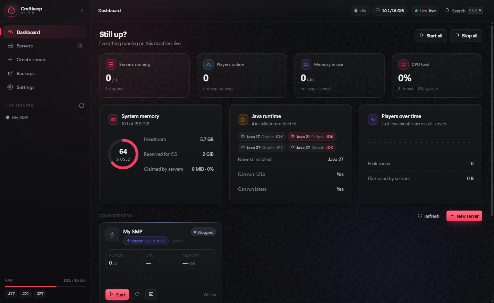

# Minecraft Server Manager

A **desktop app** that provisions, runs and monitors Minecraft servers — Vanilla, Paper and
Fabric — from one dashboard. It downloads the right jar, works out which Java the version
needs, accepts the EULA, writes an optimised `server.properties`, generates startup scripts,
streams the console live, and keeps scheduled backups.

Everything runs on your machine. Servers live in a folder you own, and nothing is sent
anywhere except the jar downloads from Mojang / PaperMC / Fabric.

> **This is not a web app.** There is no server to host, no URL to visit and no browser mode.
> See [Why there is no web version](#why-there-is-no-web-version).

<br>

## Download

**[Download for Windows](releases/latest)** — installer or portable `.zip`, from the latest
GitHub release. There is also a download page with screenshots and install notes:
**<https://ben605200-dev.github.io/MSM/>**

- **Installer** — per-user, no administrator rights required; adds Start Menu and desktop
  shortcuts.
- **Portable `.zip`** — unzip anywhere and run `Minecraft Server Manager.exe`.
- Every release also carries `SHA256SUMS.txt` and `HOW-TO-INSTALL.txt`, so a download can be
  verified before it runs.

> **Not code-signed.** Windows SmartScreen will warn you the first time. Click **More info →
> Run anyway** — the warning reflects an unrecognised publisher, not a problem with the file.



<br>

## Quick start (from source)

```bash
npm install
npm run app
```

Or, if you have installed it, launch **Minecraft Server Manager** from the Start Menu or the
desktop shortcut. Press **Create server** and the wizard handles the rest.

> **Node 20+ is required to run from source.** If `java` is not already installed, the wizard
> offers to download a matching Temurin JDK automatically — or add one under **Settings › Java**.

<br>

## What the app does

### Native shell

- **Its own window and icon** — a real taskbar entry, no browser chrome, no URL bar.
- **A system tray icon** that turns green while servers run and shows the live count. Its menu
  starts, stops, restarts and backs up individual servers without opening the window.
- **Native menus** — File / Servers / View / Help, with accelerators (`Ctrl+N` new server,
  `Ctrl+K` command palette, `Ctrl+Shift+R` restart the server you are looking at).
- **Closing the window does not stop your servers.** They keep running in the tray, because the
  point of a server host is that it stays up. **Settings › Desktop app** switches that to
  "stop servers and quit" if you prefer.
- **Notifications** when a server finishes booting or crashes — including the manager's
  diagnosis of *why* it crashed.
- **Native file dialogs** for picking a Java runtime, and **Open folder** buttons that hand a
  server directory to Explorer / Finder.
- **Graceful quit** — asking to quit stops each server, saves every world, then exits.

### Provisioning

| Step | What happens |
| --- | --- |
| 1 | Resolve the download from the source of truth — Mojang's version manifest, PaperMC's v3 API, or Fabric Meta |
| 2 | Download the jar and **verify its SHA-256** where the provider publishes one |
| 3 | Work out the required Java major from Mojang's own metadata, cross-checked against the provider and a fallback table; pick the best installed JDK, or fetch one from Adoptium |
| 4 | Write `eula.txt` with `eula=true` |
| 5 | Generate an optimised `server.properties` (merged with anything already there) |
| 6 | Size the heap for the machine and pick JVM flags |
| 7 | Write `start.bat` / `start.sh` that reproduce the exact launch |
| 8 | Seed `ops.json`, `whitelist.json` and the ban lists |
| 9 | Register the server and optionally start it |

Version numbers, Java requirements and build lists all come from live APIs, so a brand new
Minecraft release works without touching the code.

### Running servers

- Servers are child processes of the app. The console is bidirectional: output streams to the
  window, and commands go back to the JVM's stdin.
- **Status** is derived from the log, not guessed: `starting → running` on the
  `Done (x.xxs)!` line, `stopping` on `Stopping the server`, `crashed` on an unexpected exit.
- **Crashes are diagnosed.** The app reads the log tail and tells you *why* — EULA, port already
  in use, wrong Java, out of memory, incompatible mods — with a one-click fix where one exists.
- **Live CPU and RAM** per server, sampled from the OS directly (no native modules).
- **Graceful stops** escalate: `/stop` on stdin → SIGTERM → hard kill after 30 s.
- **Auto-restart** with exponential backoff that gives up after repeated rapid failures.
- **Scheduled restarts** warn players in chat, wait 60 s (cancellable), take a backup, then
  restart. **Scheduled backups** prune to a retention count.
- **Backups are consistent.** The app runs `save-off` and `save-all flush`, waits for the write
  to land, archives, then restores `save-on` — even if the archive fails. Restoring keeps a
  timestamped safety copy of the previous state.

### Interface

Dark, glassy, and built to be read at a glance: a dashboard with live stat tiles and gauges, a
full-screen console with level colouring, search, filtering and tab-completion, a grouped
settings editor for `server.properties`, a scoped file browser with an editor, a backup
browser, and per-server automation.

Keyboard: <kbd>Ctrl</kbd>+<kbd>K</kbd> command palette, <kbd>g</kbd> then
<kbd>d</kbd>/<kbd>s</kbd>/<kbd>c</kbd>/<kbd>b</kbd> to jump around, <kbd>?</kbd> for the full
list, <kbd>↑</kbd>/<kbd>↓</kbd> for command history.

<br>

## Getting players in from outside

Open a server and go to the **Connect** tab. It checks the three things that have to line up and
tells you which one is missing:

1. **The server is listening** on the network, not just this PC.
2. **The router forwards the port** — either configured by hand or requested automatically over
   UPnP.
3. **The firewall allows it** (Windows; one button, one UAC prompt).

It also compares your router's own WAN address against the address the internet sees. If those
disagree you are behind **carrier-grade NAT** — common on LTE and 5G home broadband — and port
forwarding *cannot* work, no matter how the router is configured. The panel says so instead of
letting you spend an evening on it.

### playit.gg tunnel

When forwarding is impossible, the built-in tunnel is the answer. It makes an **outbound**
connection to playit's network, which proxies players to your server, so nothing has to reach
you from outside.

- The agent is downloaded from playit's official GitHub release, and **only accepted if its
  Authenticode signature verifies** against the publisher (*Developed Methods LLC*). The bytes
  are checked against the release listing too. A binary that fails either check is deleted, not
  run.
- It runs as a managed child process with its **own IPC pipe**, so it cannot collide with a
  separately installed playit service, and it is stopped when you quit the app.
- Setup is a claim link: press **Set up a tunnel**, approve the link in your browser, and the
  panel updates itself and connects. If the link does not work for you, a secret key pasted from
  your playit.gg dashboard does the same job.

> **You need a free playit.gg account.** The agent has to be linked to one before it will carry
> traffic, and that is a sign-in the app cannot do for you. Point its tunnel at
> `127.0.0.1:<your server port>`.

<br>

## Why there is no web version

An Electron app *is* a web renderer — the interface is HTML/CSS/JS and it always will be. What
this project deliberately does **not** have is a browser-accessible server:

- **No standalone entry point.** `server/index.js` is a library with exactly one caller: the
  Electron main process. Running it directly does nothing. There is no `npm start`.
- **No fixed address.** The link between the main process and its own window uses an
  **OS-chosen ephemeral port** bound to `127.0.0.1`. There is no `localhost:31415` to visit.
- **No way in from outside.** Every API call and WebSocket upgrade must present a **session
  token generated fresh on each launch**. Only the app's own preload knows it, and it is handed
  over by synchronous IPC rather than a command-line argument, so it never lands in a process
  listing or on disk.
- **No network exposure.** Binding a LAN address is not possible — the host is hard-coded to
  loopback and the "expose on your network" configuration is gone.

Point a browser at the port and you get a plain refusal:

> **This window is not running inside the desktop app.**
> Minecraft Server Manager only runs as a desktop app. Launch it from the Start Menu, the
> desktop shortcut, or `npm run app`.

That is the whole point: the interface is a window, not a website.

<br>

## Layout

```
minecraft server host app/
├── desktop/                   Electron shell — the app itself
│   ├── main.js                instance lock, boot, window, tray, quit flow, session token
│   ├── preload.cjs            the only privileged bridge (contextIsolated)
│   ├── tray.js                tray icon + per-server menu
│   ├── menu.js                native application menu
│   ├── config.js              window geometry + desktop preferences
│   ├── splash.html            shown while the backend boots
│   └── icons/                 generated PNG/ICO artwork
├── server/                    Backend — a library, never a server you run
│   ├── index.js               exports startManager(); no CLI
│   ├── config.js              paths, resource tuning, transport token
│   ├── logger.js              colourised console + JSONL file log
│   ├── lib/
│   │   ├── processManager.js  one JVM: spawn, stdio, state machine, crash diagnosis
│   │   ├── registry.js        server CRUD, persistence, sampling loop, Provisioner
│   │   ├── consoleBuffer.js   bounded scrollback, disk mirror, replay cursors
│   │   ├── mcLogs.js          log parsing + lifecycle event detection
│   │   ├── scheduler.js       restart/backup schedules
│   │   ├── backup.js          quiesce → archive → restore (with safety copy)
│   │   ├── javaDetect.js      JDK discovery, probing, Adoptium download
│   │   ├── jvmFlags.js        reconciles preset flags with what the JDK accepts
│   │   ├── versionRules.js    Java requirement table, heap/JVM planning
│   │   ├── properties.js      server.properties schema, parse, serialise
│   │   ├── stats.js           per-process CPU/RAM (no npm dependencies)
│   │   ├── slp.js             Minecraft Server List Ping client
│   │   ├── httpClient.js      retries, TTL cache, streaming downloads + checksums
│   │   └── fsUtil.js          atomic writes, traversal-safe paths, sizing
│   ├── providers/             vanilla.js · paper.js · fabric.js · index.js
│   ├── routes/                servers · versions · java · files · system · middleware
│   └── ws/gateway.js          renderer transport: topics, throttling, backpressure
├── web/                       The interface, rendered inside the app window
│   ├── index.html
│   ├── css/                   base · components · forms · views
│   └── js/
│       ├── main.js            bootstrap, routes, shell chrome, shortcuts, palette
│       ├── router.js          hash router with lifecycle hooks and a render timeout
│       ├── store.js           observable state, wired to the transport
│       ├── ws.js              reconnecting client with gap recovery
│       ├── api.js             transport client (attaches the session token)
│       ├── desktop.js         bridge to the shell: dialogs, folders, notifications, quit
│       ├── console.js         the terminal component
│       ├── components.js      cards, badges, sparklines, gauges
│       └── views/             dashboard · servers · server · server-tabs · create · backups · settings
├── scripts/                   check-imports.mjs · make-icons.mjs · smoke-test.mjs · dev-transport.mjs
├── test/                      node:test unit tests
└── dist-app/                  packaged builds (gitignored)
```

<br>

## Commands

| Command | Purpose |
| --- | --- |
| `npm run app` | **Launch the app** |
| `npm run app:dev` | Same, with Chromium logging |
| `npm run app:debug` | Pins the internal port and logs the session token, for attaching diagnostic tools |
| `npm run dist` | Build the installer + portable ZIP into `dist-app/`, audit the bundle, write checksums |
| `npm run dist:dir` | Unpacked build, faster for a smoke check |
| `npm run audit` | Verify nothing private ships inside `app.asar` |
| `npm run checksums` | Rewrite `SHA256SUMS.txt` / `HOW-TO-INSTALL.txt` beside the artifacts |
| `npm run icons` | Regenerate `desktop/icons/` from code |
| `npm test` | Unit tests (console parser, filesystem helpers, path safety) |
| `npm run check` | Static check: imports, forgotten imports, unrendered elements |
| `npm run smoke <id>` | End-to-end API tests against a running app (needs `app:debug`) |
| `npm run verify` | `check` + `test` |

<br>

## Sharing the app

`npm run dist` produces everything needed to hand the app to someone else:

| File | What it is |
| --- | --- |
| `Minecraft-Server-Manager-Setup-<version>.exe` | Installer. Per-user, so the recipient needs no administrator rights. |
| `Minecraft-Server-Manager-<version>-win-x64.zip` | Portable build — unzip and run, no installation. |
| `SHA256SUMS.txt` | SHA-256 for each artifact, so a recipient can confirm the download. |
| `HOW-TO-INSTALL.txt` | One-page instructions written for the recipient. |

Send the installer (or the ZIP) plus `HOW-TO-INSTALL.txt`; include `SHA256SUMS.txt` if you
want them to verify the file before running it. The installer is ~116 MB, so a file
transfer service (or any chat app) is usually the way to get it there — most email
providers reject attachments this large.

The build is **not code-signed** — no certificate is configured — so Windows SmartScreen
will show *"Windows protected your PC"* the first time a recipient runs it. They click
**More info → Run anyway**. That warning only reflects an unrecognised publisher; it does
not indicate a problem with the file, and buying a code-signing certificate is the only
way to remove it.

Each build runs `npm run audit` before finishing. It reads the `app.asar` file table and
fails the build if any local state has leaked in — `data/`, `servers/`, `.env`, logs or
archives — then asserts the entry point, UI and runtime dependencies are all present. An
installed app keeps every bit of its state in the recipient's own
`%APPDATA%\Minecraft Server Manager`; nothing is shared between machines.

### Publishing a release

The repo at `github.com/ben605200-dev/MSM` distributes the same files through GitHub — the
download page reads the newest release automatically, so nothing on the site needs editing:

```powershell
# 1. Bump "version" in package.json, then build
npm run dist

# 2. Tag it and attach the artifacts (name them for the new version)
gh release create v1.0.1 --title "v1.0.1" --notes "What changed..." `
  "dist-app\Minecraft-Server-Manager-Setup-1.0.1.exe" `
  "dist-app\Minecraft-Server-Manager-1.0.1-win-x64.zip" `
  "dist-app\SHA256SUMS.txt" "dist-app\HOW-TO-INSTALL.txt"
```

<br>

## Where your files go

| | Running from source | Installed build |
| --- | --- | --- |
| Servers | `./servers` | `%APPDATA%\Minecraft Server Manager\servers` |
| Backups, logs, downloaded JDKs | `./data` | `%APPDATA%\Minecraft Server Manager\data` |
| Window preferences | — | `%APPDATA%\Minecraft Server Manager\desktop-config.json` |

Overridable with `MCSM_SERVERS_DIR` and `MCSM_DATA_DIR`. **File › Where are my files?** shows the
real paths and opens the folder. See `.env.example` for everything else.

### Developing the interface

The UI is bundled inside a read-only `app.asar` in an installed build, so front-end changes
normally need a rebuild and reinstall. To skip that, point an installed build at a source
checkout:

```powershell
$env:MCSM_WEB_DIR = "C:\dev\minecraft-server-manager\web"
& "$env:LOCALAPPDATA\Programs\Minecraft Server Manager\Minecraft Server Manager.exe"
```

The startup log prints `Serve UI from …` so you can always tell which copy is live.

<br>

## Security model

The app can start processes and write files, so it is treated as a privileged surface.

- **The window is sandboxed from the shell.** `contextIsolation` is on, `nodeIntegration` is
  off, and the only bridge is a fixed list of named functions in `desktop/preload.cjs` — the
  page can ask the shell to reveal a path, show a dialog or quit, and nothing else. Paths passed
  to `revealPath` are re-validated in the main process and refused if they fall outside the
  app's own folders.
- **The renderer cannot navigate away.** External links open in the real browser, and in-app
  navigation is refused unless it targets the internal transport.
- **The transport is private.** Loopback only, ephemeral port, per-launch session token,
  timing-safe comparison, plus `Origin` and custom-header checks as defence in depth. See
  [Why there is no web version](#why-there-is-no-web-version).
- **Path traversal is not possible.** Every file path goes through `safeJoin`, which rejects
  `..`, absolute paths, drive letters, NUL bytes and Windows device names, and verifies the
  resolved path still sits inside the server's own directory.
- **No shell.** Processes are spawned with an argument array — there is no shell to inject into.
- **File deletion is bounded.** The app refuses to delete anything outside `servers/`, and
  protected files (`server.properties`, `eula.txt`, the server jar) cannot be removed from the
  interface.
- **Region files are protected** from editing while the server is running, and backups refuse
  to restore over a live world.

<br>

## How the tricky parts work

**Java for a given Minecraft version.** Mojang publishes `javaVersion.majorVersion` in each
version's metadata. PaperMC publishes its own `java.version.minimum`. Where neither is
available the app falls back to a table. It takes the **maximum** of all three, because any one
of them can be the strictest. It then picks the best installed JDK — exact match first, then the
lowest newer version.

**JVM flags that survive JDK upgrades.** Preset flag sets rot: Java 27 removed
`-XX:+ParallelRefProcEnabled` and renamed `InitiatingHeapOccupancyPercent` to `G1IHOP`. Rather
than hard-code a compatibility table that decays, `jvmFlags.js` launches the target JVM once
with the candidate flags, reads the warnings, drops or renames what it rejects, and caches the
result per JDK. A hand-launched `start.sh` therefore gets the same flags as the app.

**Console scrollback that survives a restart.** Every server's console is mirrored to
`data/logs/servers/<id>.log`. On boot the app replays the tail of that file into memory, so
restarting the app doesn't leave you staring at an empty console. A transport reconnect sends its
last sequence number and receives exactly the lines it missed.

**Windows line endings.** A Windows server writes `\r\n`. Treating a trailing `\r` as an in-line
rewrite silently discards *every* line, which is why `splitLines` strips the terminator before
looking for genuine carriage-return rewrites — pinned by a unit test.

**Live resource sampling without native modules.** Linux reads `/proc/<pid>/stat`; macOS uses one
batched `ps`; Windows uses one batched PowerShell call for *all* PIDs per tick. CPU is derived
from the delta of cumulative CPU time, so it matches what Task Manager shows.

<br>

## Troubleshooting

**Windows Firewall asks whether to allow the app on public/private networks** — **click Cancel.**
The app never listens on a network interface: it opens exactly one socket, on `127.0.0.1`, on an
OS-chosen port. You can confirm that yourself while it is running:

```powershell
Get-NetTCPConnection -State Listen |
  Where-Object OwningProcess -in (Get-Process "Minecraft Server Manager").Id |
  Select-Object LocalAddress, LocalPort
```

You will see one row, `127.0.0.1`. The prompt comes from Chromium's networking stack probing at
startup, not from this app requesting inbound access — so "Allow" would create inbound firewall
rules that nothing ever uses.

**"This window is not running inside the desktop app"** — you opened the internal port in a
browser. Launch the app properly: `npm run app`, or the Start Menu shortcut.

**A server says "Wrong Java version"** — open **Settings › Java**, install the version the
diagnostics panel names, then point the server at it in **Automation**, or reinstall its jar if
the version itself is wrong.

**A server won't start and the console shows nothing** — check `data/logs/servers/<id>.log`,
which holds the raw output including anything the parser dropped.

**CPU/RAM widgets read zero on Windows** — the sampler needs `powershell.exe` or `pwsh.exe` on
`PATH`. The log will say so at startup.

**Servers stop when I quit the app** — that is the default only if you set
**Settings › Desktop app › When I close the window** to "stop servers and quit". Closing the
window normally leaves them running in the tray. Quitting always stops them cleanly.

<br>

## Notes and limitations

- Not a multi-user system: it is a single-operator local tool. Use the OS user account for
  separation.
- The interface is dependency-free ES modules on purpose — no bundler, no build step, no CDN.
  Assets are served with `no-cache` + ETag, so a UI update never leaves a stale module graph.
- RCON is configurable but the console uses the process's stdin, which is faster and cannot
  desynchronise.
- Only Vanilla, Paper and Fabric are supported. Bukkit/Spigot/Forge were left out deliberately:
  Forge needs an installer with a licence prompt, and Bukkit's jar distribution is not stable.
